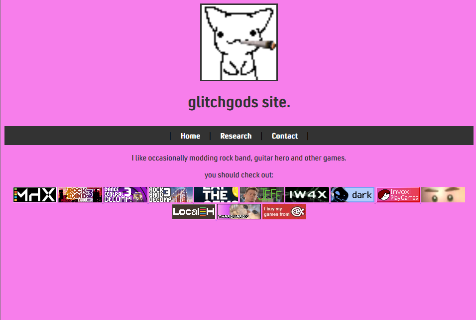
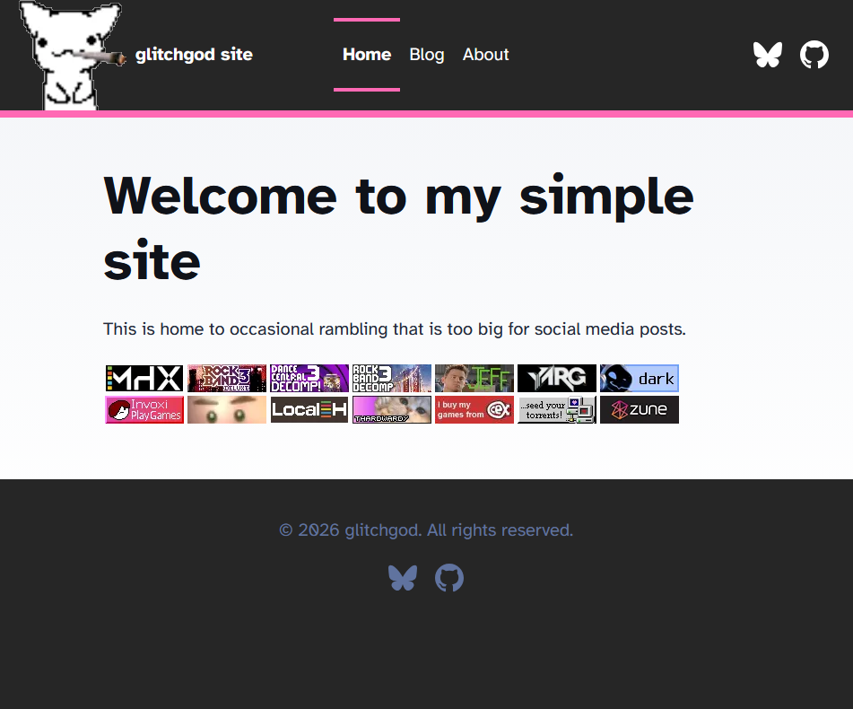

## Intro
If you are reading this, my new site design is live! This should look miles better than the old design, the old design was basic HTML. It was a nice learning experience but writing articles for it was quite annoying,
that isn't to say this hasn't been a challenge. The new design is now using Astro, I started with the basic blog template and went from there.

## The Header
The header was quite a big challenge to it get the way I wanted, I did have to compromise on my ideas a bit but I think the current design matches alot better with the rest of the site rather than the planned one.
The planned design was very similar, Pink border leading into main page contents, few buttons on a bar. Whats different was that a white border would be on the top side of the bar and the icon would be on that with a logo.
The BlueSky icon was a bit annoying to get right as I couldn't find a good SVG that fit right for quite a while.

## The Footer
The footer was very simple once I had got the header finished. All I did was change the color, switch Mastodon for BlueSky and change some text.

## Main Page
Getting the main page correct was a bit tasking. I was toying around with potentially auto-adding each 88x31 badge from the image folder by using some kind of Astro component but then I remembered they need to have links and alt text and etc, I was having so much trouble with it so I was happy to kill that method. 

## Blogs
Im quite happy with how the articles are setup. I like the basic banner designs. I decided to move the articles from the old site to its own destinct section since they don't have the best quality, They have some information that might prove useful to others so I'm against deleting it as a whole.

# Comparison

